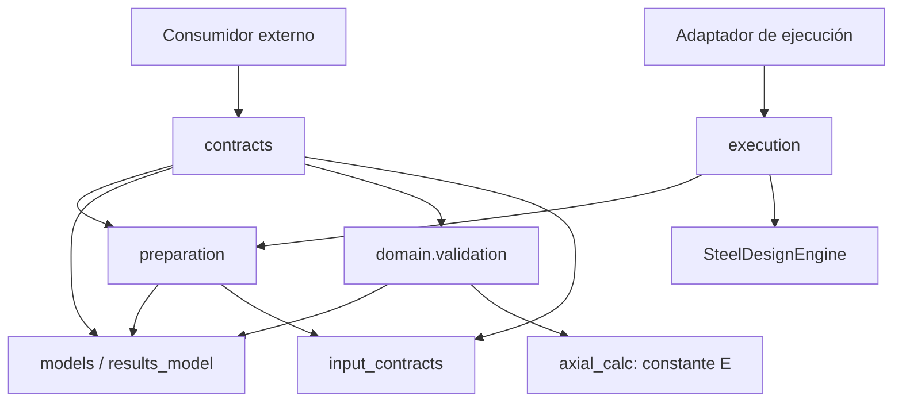

# HFS-022Q — Auditoría final de calidad arquitectónica

Fecha: 2026-10-28. Base: `main`,
`449549d9fcc73159d40924b83be988c29ebe196e`, inicialmente sin cambios locales.
Estado: entrega para revisión independiente, sin nota autoasignada. No se
crearon ramas, commits, pushes ni PR. No se inicia HFS-023/024 ni web.

## Resumen ejecutivo

Se conserva **todo el código productivo** de HFS-022R. La auditoría no encontró
un defecto funcional o de responsabilidad que justifique una refactorización
en el alcance examinado. Se añade evidencia antes ausente: consumidor externo
que no importa fixtures previos, veinte documentos escritos manualmente con
esperados fijados antes de ejecutar y medidas reproducibles de complejidad,
anidamiento y dependencias. No se pretende mejorar una cifra dividiendo módulos.

La base tiene [CI 40788962500](https://github.com/Beicker29/StructureLab_HFS/actions/runs/40788962500)
SUCCESS, Ubuntu 24.04 y Windows 2022, para el SHA exacto. Se consultó la API
pública durante la preparación; [respuesta resumida](evidence/base-ci.json).
El conector GitHub no estaba disponible; web y HTTP PowerShell fallaron antes
de obtener la respuesta con urllib y permiso de red. Ningún workflow fue
disparado. Esa CI corresponde a la base, no al suplemento local HFS-022Q.

La revisión anterior asignó 97/100 según la solicitud del usuario; esta entrega
aporta evidencia para que otra revisión decida la evaluación final. F-31 sigue
**P0 abierto**. La calidad del transporte no es validación normativa AISC.

## A1 — Arquitectura y consumidor externo

Se construye un wheel desde el sdist actual y se instala junto con una
instalación normal del proyecto y una editable en tres entornos externos.
El consumidor [probe_hfs022q_consumer.py](../../../../scripts/probe_hfs022q_consumer.py)
se copia a la carpeta de entradas externa. Usa Python `-I -B`, con cwd fuera
del checkout, sin PYTHONPATH, sin modificar sys.path y sin imports de tests.
Solo las instalaciones editable resuelven src, conforme a su contrato; normal
y wheel resuelven site-packages. No se copia código productivo a las entradas.

Sus documentos provienen de [manual.json](../../../../tests/fixtures/hfs022q/manual.json).
Lee el archivo como consumidor **antes** de instrumentar la API. Luego utiliza
exclusivamente `load_json`, `validate_document`, `dump_json` y `ContractError`:
entradas individuales, bundles, checks, EngineResult y CoverageReport.
Comprueba aceptación/rechazo, errores, roundtrip determinista y no mutación.
No llama dump_json para fabricar ningún esperado; solo lo usa como operación
bajo prueba contra el documento manual y para comprobar estabilidad posterior.

Durante la fase contractual bloquea imports de ejecución, motor, router,
reglas, evaluadores, repositorio, geometría, CLI y reporting. Un audit hook
bloquea lecturas de JSON/XLSX/PDF/SVG, escrituras, creación/eliminación/renombre
de archivos, conexiones y subprocess; un perfilador bloquea llamadas a funciones
de `steel_design.codes`. Se permiten las lecturas normales del importador Python
para cargar código. Ningún archivo se genera en el cwd del consumidor.

La segunda fase importa explícitamente las rutas públicas de execution, donde
es legítimo cargar el motor para sus anotaciones. La primera fase tiene que
terminar sin ese import. Se comprueba la identidad de OutputOptions respecto
del tipo recibido por contratos, así como los cinco reexports con su módulo
definidor ya cargado mediante introspección. No se importa una API privada para
hacer funcionar al consumidor. Se prepara un bundle con resultados efectivos
manuales; nunca se llama al motor. Esta separación evita presentar la carga
esperada de execution como dependencia oculta de contracts.

### Grafo real y fronteras



La fase contractual carga 16 módulos de steel_design, sin engine/execution/
run/reporting/router/reglas/repositorio. Se conserva el import de la constante
E desde axial_calc requerido por domain.validation; no se ejecuta su función
de cálculo ni se duplica el valor para reducir el grafo. La lista exacta, rutas
de origen, sys.path, firmas y comandos por instalación están en
[external-consumers.json](evidence/external-consumers.json).

El [grafo estático](evidence/dependency-graph.json) inspecciona los 46 módulos
del paquete, incluidos imports dentro de funciones. No detecta ciclos entre
módulos propios. No pretende analizar el interior de Pydantic ni cualquier
import dinámico arbitrario; el proceso nuevo aporta el contraste de ejecución.

| Política / responsabilidad | Propietario canónico | Consumidores y decisión |
|---|---|---|
| Tipos estrictos, política local y claves duplicadas | input_contracts + modelos | Preparación/contratos/CLI; conservar |
| Merge profundo, opciones y preparación local perezosa | preparation | contracts y execution; conservar reexports, sin wrappers |
| Relaciones y bloqueos de caso | domain.validation y dominio de método | Motor y frontera contractual; conservar guardas originales |
| Envoltura/versión, migración explícita, comparación e integridad de transporte | contracts | Consumidores externos optativos; no acoplar a CLI |
| DCR y estado bruto del check | CheckResult.from_values | Reglas y cotejo de contrato, sin duplicar cociente productivo |
| Estado agregado y completitud | EngineResult.aggregate / CoverageReport.complete | Motor/contrato; no inferir desde reglas ejecutadas |
| Generación del esquema | contracts.get_schema y modelos | Script de generación; jsonschema es un consumidor independiente de desarrollo |
| Ejecución secuencial | execution → motor | CLI/API; no participa en la validación contractual |

## A2 — Métricas y evaluación crítica del código

[audit_hfs022q.py](../../../../scripts/audit_hfs022q.py) lee AST sin importar
producción. No se añade dependencia de medición. La convención de complejidad
ciclomática usada es **1 + puntos de decisión**: if/expresión condicional,
for/while, assert, cada except, operadores cortocircuitados adicionales y
generadores/filtros de comprehensions. Else/finally/with no suman decisiones.
Se excluyen cuerpos de funciones/clases internas al medir la función externa.
No se etiqueta como resultado Radon ni se establece un umbral de aprobación.

La profundidad cuenta construcciones de control (incluidos try/with/except)
y generadores/filtros anidados; operadores booleanos no añaden profundidad.
Por ello no es el simple sangrado visual. Tamaños: líneas físicas totales y
no vacías, incluyendo comentarios/docstrings; función desde def hasta su fin.
Tres ejemplos pequeños contados manualmente calibran la convención:
[metrics-calibration.json](evidence/metrics-calibration.json). Los resultados
de **cada función**, no solo máximos, se conservan en [metrics.json](evidence/metrics.json).

| Módulo | Líneas / no vacías | Funciones/métodos | Máx. líneas de función | Máx. CC | Máx. anidamiento | Fan-in / fan-out propios |
|---|---:|---:|---:|---:|---:|---:|
| contracts | 419 / 364 | 20 | 46 | 29 | 5 | 0 / 6 |
| preparation | 82 / 67 | 4 | 21 | 9 | 4 | 2 / 4 |
| execution | 57 / 44 | 4 | 8 | 3 | 1 | 2 / 5 |
| input_contracts | 40 / 30 | 1 | 11 | 3 | 2 | 6 / 0 |

Fan-in/fan-out cuenta módulos propios distintos, no stdlib/terceros ni llamadas.
El cero de contracts refleja su carácter optativo: consumidores externos y
tests no pertenecen al grafo productivo. OutputOptions/InputModel no declaran
métodos propios; no se suman funciones heredadas de Pydantic.

### Funciones críticas

| Función | CC / líneas / profundidad | Juicio técnico y evidencia |
|---|---|---|
| _coverage_integrity | 29 / 35 / 3 | Complejidad elevada y concentrada en invariantes de un solo grafo: unicidad, continuidad, enlaces, aplicabilidad y aceptación. Cada rechazo tiene código/ruta. Conservar: separarla ahora repartiría los mismos conjuntos/índices sin corregir un defecto. Manual pending/index/contradiction más once mutaciones históricas de cobertura y diagnósticos HFS-022R |
| _same | 16 / 17 / 3 | Recursión por tipo JSON, presencia, igualdad exacta, bool y cero con signo; no es otra validación normativa. Casos de derivados/defaults, roundtrip y enteros sin pérdida |
| _output_integrity | 16 / 24 / 5 | Adapta salida individual/compuesta y delega decisión a from_values; no reconstruye resistencia. Manual 50/100 y 150/100, contradicción DCR, placeholders históricos |
| _validate | 15 / 43 / 5 | Una frontera con dispatch de cinco tipos, ubicación de excepción y consumo perezoso para diagnóstico de bundle. El anidamiento try/except explica parte de la medida. Mantener orden y causas; las 20 entradas manuales contrastan caminos independientes |
| _strip_derived | 13 / 14 / 4 | Usa metadatos Pydantic para no retirar campos de mapas opacos. Es distinta de validación/reconstrucción; prueba manual conserva details.display y regresión HFS-022R comprueba otros nombres |
| get_schema | 9 / 46 / 4 | Mayor función por líneas: construye envoltura y adapta snapshots/fragmentos desde modelos, sin copiar reglas. Diez esquemas congelados y validación independiente |
| prepare_cases | 9 / 21 / 4 | Preparación secuencial con merge, etiquetas y opciones; no calcula. Resultado efectivo manual del bundle y regresiones previas de orden/pereza |

No se oculta el CC 29 ni se interpreta una suite verde como cobertura de todas
las combinaciones posibles. La responsabilidad es cohesiva y las decisiones
son verificables; no se observa un problema mayor que justifique una división
en este hito. Si cambia la política de integridad, esa función exige revisión
especial y nuevos casos de frontera; esta conclusión no es una autorización
para añadir indefinidamente condiciones a ella.

### Responsabilidades, duplicación y mutabilidad

Conteo cualitativo explícito por módulo, no métrica automática: contracts tiene
**cuatro grupos** dentro de una frontera (envoltura/codec, revalidación e
integridad, migración y schemas); preparation tiene **tres** (merge, opciones,
preparación/forma); execution **uno** (orquestación en memoria); input_contracts
**dos** (política local y duplicados JSON). Estos grupos comparten consumidores
y contrato; contar más de uno no obliga a crear otro módulo.

No se encontró una segunda implementación de las políticas listadas. `_read`
y load_json/validate_document recorren defensivamente la misma validación;
no contienen copias de sus reglas. `_model_data` inspecciona valores declarados
antes de serializar; `_strip_derived` retira solo metadatos calculados, y
`_same` compara. Son recorridos parecidos con funciones distintas. La proyección
legacy `finite_json_payload` preserva diagnósticos de no finitos, mientras el
transporte 1.0 rechaza pérdida: unificarlos cambiaría sus contratos.

Las fachadas vigentes son reexports por identidad y tienen compromiso
HFS-021/021A/022R. No hay código sustituido en Q que retirar. La repetición de
documentos manuales se conserva deliberadamente como evidencia independiente,
no como segunda fuente productiva.

Las firmas públicas tipan tipos de contrato, modelos de payload y retorno;
dict/Any se limita a bundles y mapas dinámicos cuyo contenido no está acreditado
normativamente. No se añade TypedDict/DTO paralelo para aparentar precisión.
ContractDocument es frozen en su envoltura, **no profundamente inmutable**.
dump_json revalida; validate_document trabaja con copia y prepara modelos.
Las pruebas nuevas comprueban no mutación del original tanto al aceptar como
al rechazar; las históricas comprueban modelos mutados/model_copy y rechazo sin
reparación silenciosa. No se ofrece sincronización frente a mutación concurrente.

## A3 — Documentos y esperados independientes

Se escribieron manualmente veinte documentos y sus esperados en un archivo
JSON, sin ejecutar motor/generadores para construirlos. Su hash se registró
**antes de la primera ejecución**, en [preparation.json](evidence/preparation.json),
y se coteja al cierre. Los esperados no se alteraron para pasar la suite.
La [nota de procedencia](../../../../tests/fixtures/hfs022q/README.md) identifica
qué se comprueba y las diferencias legítimas de representación.

Los resultados manuales tienen capacidades sintéticas: 50/100 = 0,5 y
150/100 = 1,5. El primer check es PASS; el segundo FAIL permanece en
known_failures aunque el caso sea INCOMPLETE por falta de cobertura. Una
obligación pendiente con cero resistencias acreditadas da complete=false.
Estas son identidades aritméticas/reglas documentadas de transporte y estado,
no oráculos de capacidades AISC ni resultados copiados del motor.

### Matriz de decisiones

S = JSON Schema congelado, ambos modos; P = API Python. Aceptar/rechazar se
fijó en el fixture y se comprobó realmente. Detalle de las decisiones, errores
del validador, causas y hashes de roundtrip: [interoperability.json](evidence/interoperability.json).

| Caso manual | S | P | Código / JSON Pointer esperado al rechazar |
|---|---|---|---|
| input_complete | acepta | acepta | ASD compresión, todos los campos del caso explícitos |
| input_omitted | acepta | acepta | Omisiones opcionales preservadas |
| input_defaults | acepta | acepta | Defaults explícitos preservados |
| input_directional | acepta | acepta | Signos y componentes sin transformar |
| bundle_partial | acepta | acepta | Overrides de Pu, Fu y output, base preservada |
| missing_required | rechaza | rechaza | INVALID_PAYLOAD /payload/material |
| invalid_number | rechaza | rechaza | INVALID_PAYLOAD /payload/loads/Pu |
| unknown_version | rechaza | rechaza | UNSUPPORTED_VERSION /contract_version |
| invalid_enum | rechaza | rechaza | INVALID_PAYLOAD /payload/design_method |
| extra_field | rechaza | rechaza | EXTRA_FIELD /a~1b~0c |
| contradictory_material | acepta | rechaza | INVALID_PAYLOAD /payload/material |
| empty_bundle | rechaza | rechaza | INVALID_PAYLOAD /payload/cases |
| duplicate_json_key | acepta objeto decodificado | rechaza texto | INVALID_JSON, ruta vacía |
| check_consistent | acepta | acepta | DCR 0,5, display y entero dinámico exacto |
| check_inconsistent_dcr | acepta | rechaza | CHECK_CONFLICT /payload/dcr |
| engine_incomplete | acepta | acepta | INCOMPLETE conserva known_failures [0] |
| coverage_pending | acepta | acepta | PENDING, complete=false |
| coverage_invalid_index | acepta | rechaza | COVERAGE_CONFLICT /payload/executions/0/check_index |
| coverage_contradiction | acepta | rechaza | COVERAGE_CONFLICT /payload/obligations/0/accepted_checks |
| derived_manipulation | acepta | rechaza | INCONSISTENT_PAYLOAD /payload/known_failures |

Por modo: esquema acepta 14/rechaza 6; Python acepta 8/rechaza 12. Las seis
diferencias tienen motivo contractual: relación Fu/Fy, pérdida de duplicados
al decodificar, DCR, índices, evidencia aceptada y derivados. Un validador de
schema recibe un objeto, no conserva claves repetidas del texto original;
por eso se comprueba load_json con el texto duplicado sin preprocesarlo.
La ruta vacía está documentada: el object_pairs_hook original no conoce su
posición en el documento. No se inventa un JSON Pointer ni se cambia el parser.

Se prueban validación y serialización sobre los archivos congelados; no se
llama get_schema para construir ni corregir los esperados. Los roundtrips
aceptados conservan valores y presencia de campos, no el espaciado original ni
la grafía entera de un campo float (50 frente a 50.0). El entero dinámico
9007199254740993 permanece exacto. Las pruebas previas de igualdad ingenieril
y representación histórica se conservan sin relajar tolerancias.

## Regresión e integridad ingenieril

Entorno local: Windows, Python 3.12.10, pytest 9.1.1, jsonschema 4.26.0,
Pydantic 2.14.1/core 2.50.1, openpyxl 3.1.5, build 1.6.1, Ruff 0.17.3,
twine 7.0.0. Dependencias completas en los freezes de herramientas, tres
instalaciones runtime y entornos de prueba. No se instaló una dependencia
nueva para Q. Los tres consumidores pasaron antes de instalar pytest/jsonschema
en los entornos externos; jsonschema no pertenece al runtime.

Comandos principales ejecutados, con Git de GitHub Desktop en PATH:

```powershell
.venv/21dev/Scripts/python.exe -m pytest -q -ra --tb=short -p no:cacheprovider tests/test_hfs022q_independent.py --basetemp=.venv/22q-work/targeted-temp --junitxml=.venv/22q-work/targeted.xml
.venv/21dev/Scripts/python.exe -X utf8 scripts/verify_hfs020.py --out .venv/22q-verification
.venv/21dev/Scripts/python.exe -X utf8 scripts/audit_hfs022q.py --capture .venv/22q-verification
```

Los comandos exactos con rutas absolutas, cwd y overrides están en las
capturas; el primero está en development.zip/targeted.json. Primera ejecución
de los documentos manuales: **42 aprobadas, exit 0**, sin correcciones de
producción ni de expectativas. Verificación completa posterior: **2352 pruebas
+12 subpruebas históricas**, en **18 suites**, exit 0.

| Suite | Aprobadas |
|---|---:|
| Original | 68 +12 subpruebas |
| Caracterización HFS-000 | 12 |
| HFS-011 | 665 |
| HFS-016 | 44 |
| HFS-010 | 57 |
| HFS-012 | 61 |
| HFS-013 direccional/H3 | 57 |
| HFS-013 método | 73 |
| HFS-014 | 72 |
| HFS-015 | 84 |
| HFS-017 | 468 |
| HFS-020 comparación | 50 |
| HFS-021 ejecución | 51 |
| HFS-021A API | 28 |
| HFS-021A SVG | 29 |
| HFS-022 | 233 |
| HFS-022R | 258 |
| HFS-022Q | 42 |
| **Total** | **2352 +12 subpruebas** |

Todas: **0 fallidas, 0 errores, 0 omitidas, 0 xfail, 0 xpass**. La suite
original produce 80 entradas JUnit al incluir subpruebas; no son 80 métodos.
Las 2310 pruebas previas permanecen intactas y pasan. Adicionalmente se repiten
las 28 de API y 258 HFS-022R en editable según el verificador vigente, sin
sumarlas al total. Los tres consumidores directos cubren los veinte documentos
y los reexports en normal/wheel/editable; tampoco inflan el conteo de pytest.

| Verificación | Resultado real |
|---|---|
| Wheel/sdist y allowlist | Exit 0; 46 fuentes del paquete idénticas al checkout |
| Normal, wheel, editable; import y CLI externos | Exit 0; no fuente productiva copiada a entradas |
| Consumidor manual externo | Exit 0 en las tres instalaciones; 16 módulos contractuales, 20 decisiones y cinco reexports coherentes |
| Ruff, pip check, twine check --strict | Exit 0; pip check también tras herramientas de pruebas |
| Esquemas congelados con --check | Exit 0 en las tres instalaciones; diez esquemas sin cambios |
| Draft 2020-12 independiente | 40 combinaciones fixture/modo conformes a sus esperados, además de regresión HFS-022R |
| Doce ejemplos del motor | Igualdad exacta contra la referencia histórica HFS-017 |
| Veinticuatro escenarios CLI/memoria | Comparador histórico y procedencia aprobados; JSON/estados/exits preservados |
| Seis SVG | Aprobados bajo política histórica que solo permite CRLF/LF; originales archivados |
| Git | Producción y expectativas históricas intactas; ningún cambio de fórmula/estado/cobertura |

Los rechazos del namespace retirado y catálogo por defecto ausente siguen
con exit 1 **esperado** en las tres instalaciones. No son regresiones. No se
modifica el comparador ni una tolerancia. Al no cambiar producción no se
presenta una doble ejecución como antes/después: se ejecuta la suite completa
actual y se contrasta con los históricos comprometidos, más identidad de Git
y wheel. La verificación existente conserva valores brutos, métodos, signos,
ejes, unidades, estados, trazas y cobertura bajo su política exacta.

## Cambios y evidencia reproducible

| Archivo / grupo | Motivo |
|---|---|
| tests/fixtures/hfs022q/manual.json y README.md | Especímenes/esperados independientes y procedencia |
| tests/test_hfs022q_independent.py | 40 verificaciones por fixture/modo y dos consumidores en procesos nuevos |
| scripts/probe_hfs022q_consumer.py | Consumidor externo autónomo con instrumentación de frontera y reexports públicos |
| scripts/audit_hfs022q.py | AST, matriz observada, prueba de alcance y archivo; reutiliza archive histórico |
| scripts/verify_hfs020.py | Copia recursos nuevos, incorpora suite separada y consumidor con tres instalaciones |
| CONTRIBUTING.md | Reproducción y conteos nuevos conservando historia |
| docs/ROADMAP.md, docs/architecture/dry-inventory.md | Estado actual y conservación de propietarios; sin nueva arquitectura |
| docs/audit/hfs022/final-quality-review/ | Informe y capturas de esta auditoría |

No se modifica src, el contrato 1.0, la distribución 0.2.0, las dependencias,
las expectativas anteriores ni informes históricos. No fue necesaria una
corrección productiva: por tanto no hay una alternativa de refactorización
implementada ni una eliminación de código sustituido que justificar.
Se descarta dividir contracts por líneas/CC, duplicar validadores o añadir
servicios: no resuelven un defecto demostrado por esta auditoría.

El [inventario completo](evidence/file-inventory.json) identifica archivos y
hashes con exclusiones autorreferentes. [scope.json](evidence/scope.json)
coteja Git base con fuentes, catálogo, tests previos, esquemas y evidencia
histórica, y demuestra identidad del wheel con el código actual. Los originales
de los resultados anteriores permanecen en sus directorios.
`verification.zip` conserva comandos, cwd, exits, stdout/stderr, JUnit, freezes,
wheel/sdist y seis SVG originales; `development.zip` conserva la prueba dirigida.
Cada miembro tiene tamaño/hash en archives.json; SHA256SUMS.json identifica
los archivos del suplemento. No se sobrescribe HFS-022R.

Dos intentos iniciales del **nuevo auditor de archivos**, posteriores a las
pruebas exitosas, fallaron: primero trataba un JSON histórico CRLF como si su
blob Git LF debiera coincidir en bytes; después Git show encontró una ruta
histórica larga en Windows. Se corrige solo esa herramienta: usa el blob por
ID, comprueba la identidad con el filtro clean configurado por Git cuando los
bytes difieren y activa core.longpaths únicamente en la invocación. Conserva
hashes del blob y del archivo, sin cambiar configuración persistente, permisos
ni archivos históricos. Esto no normaliza resultados ingenieriles ni SVG en
sus comparadores. Un tercer intento encontró una restricción del sandbox al
abrir el wheel construido; se usa el mismo mecanismo de permisos autorizado
para inspeccionarlo, sin cambiar ACLs. Los incidentes quedan registrados en
development.zip; no son fallos de las suites ni defectos normativos.

Las 31 advertencias de acceso iniciales corresponden a temporales históricos
(10 en .tmp_test, una caché pytest, 20 en tests/.tmp_tests); se preservan sin
limpieza ni cambio de permisos. Las ejecuciones usan temporales nuevos fuera
del checkout mediante los permisos del entorno, sin convertir errores de
infraestructura en xfail.

## Riesgos residuales y recomendación

La evidencia respalda la frontera arquitectónica, la compatibilidad y la
interoperabilidad en los casos declarados. No demuestra todas las combinaciones
de campos ni ausencia universal de defectos. La complejidad de integridad
referencial requiere atención al evolucionar el contrato; sus cruces actuales
recorren obligaciones por ejecuciones y no se ha medido rendimiento con
documentos masivos. No se añaden límites de tamaño/profundidad ni políticas de
servicio web en este hito. Un payload coherentemente falsificado no queda
autenticado por estas guardas. Los mapas dinámicos no constituyen acreditación
normativa; el programa no verifica combinaciones de carga externas.

F-31 sigue P0 abierto, junto con los demás defectos normativos del seguimiento.
No se cambian demandas, capacidades, DCR, factores LRFD/ASD, selección, cobertura,
estados, unidades/ejes, trazas, geometría o ecuaciones. Las capacidades manuales
de los fixtures no cierran ningún hallazgo de ingeniería.

Recomendación: presentar A1/A2/A3 y sus límites a revisión independiente. No se
autoasigna 100/100 ni aprobación plena. Tras el commit que decida publicar el
usuario, es obligatorio obtener CI SUCCESS Windows y Ubuntu para **ese SHA**;
la CI de 449549d9 no acredita las adiciones locales. No se avanza a otro hito.
